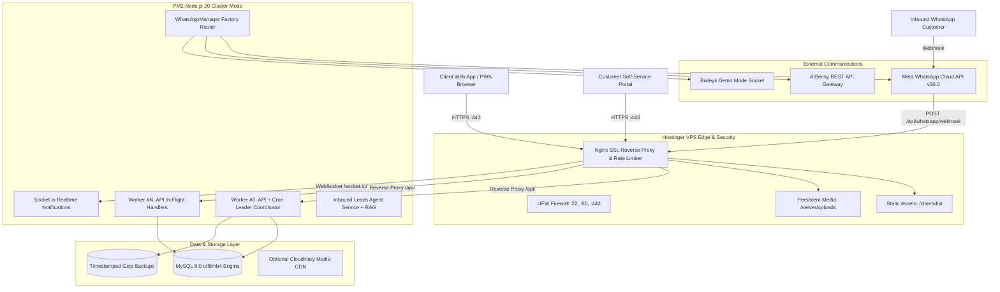

# O3 Car Spaa — System Architecture & Multi-Tenant Design

Comprehensive architectural reference detailing system topology, tenant isolation boundaries, data flows, and security domains.

---

## 🏛️ System Architecture Topology



---

## 🏢 Multi-Tenant Franchise Isolation Model

### 1. Data Modeling & Scoping
Every major business entity belongs to a franchise via `franchise_id INT UNSIGNED NOT NULL`:
- `job_carts`
- `leads` & `lead_conversations`
- `services` & `packages`
- `inventory`
- `franchise_whatsapp_settings`
- `franchise_inventory_pricing`

### 2. Authorization Hierarchy
- **`super_admin`**: Platform owner (HQ). Can switch context dynamically via `X-Franchise-ID: <id>` header, or view all franchises concurrently (`X-Franchise-ID: all`).
- **`admin` (Franchise Admin)**: Studio branch manager. Strictly locked to their assigned `franchise_id` in database queries (`req.franchiseId`).
- **`manager` / `staff` (Detailer, Technician)**: Branch employees. Can only view assigned job cards and inventory for their branch.
- **`customer`**: Vehicle owner. Can only view their own bookings, vehicles, and loyalty records.

### 3. Middleware Enforcement ([auth.js](server/src/middleware/auth.js))
```javascript
// Strict enforcement: Non-Super-Admins can NEVER override their franchise scope
if (isSuperAdmin) {
  req.franchiseId = requestedHeaderFid ? parseInt(requestedHeaderFid, 10) : 1;
} else {
  req.franchiseId = userFranchiseId; // Enforced from verified JWT payload
}

// Uniform Query Condition Generator:
req.getFranchiseCondition = (columnAlias = 'franchise_id') => {
  if (req.isGlobalAdmin) return { clause: '', params: [] };
  return { clause: ` AND ${columnAlias} = ?`, params: [req.franchiseId] };
};
```

---

## 🔄 Core Data Flows

### 1. Detailing Job Card Lifecycle
```text
Customer Arrives ➔ Vehicle Lookup / Registration
                 ➔ Pre-Inspection Checklist (Exterior, Scratches, Fuel, Valuables)
                 ➔ Job Card Created ('draft')
                 ➔ Technician Assigned ('open')
                 ➔ Washing & Detailing Execution
                 ➔ Quality Check & Before/After Photos
                 ➔ Stage Complete ('complete')
                 ➔ Puppeteer Generates Tax Invoice & Warranty Card PDF
                 ➔ WhatsApp Notification with PDF Link Sent to Customer
```

### 2. Inbound Leads Agent & Conversational AI
```text
Inbound WhatsApp Message ➔ Webhook Verification
                        ➔ Check STOP / Opt-Out (suppress if opted out)
                        ➔ Check Human Takeover Mode (handoff to staff if active)
                        ➔ Guardrail Check (profanity, competitive pricing, legal)
                        ➔ RAG Catalog Retrieval (finds exact car model & package price)
                        ➔ LLM Generates Grounded Answer (no hallucinated pricing)
                        ➔ Lead Qualified & Stage Updated in Unified CRM
                        ➔ Customer Proposes Slot ➔ Slot Scheduled
```

---

## 🛡️ Security Boundaries & Hardening

1. **Defense-in-Depth Layering**:
   - **Network**: UFW blocks all ports except 22, 80, and 443. Fail2ban protects SSH from brute force.
   - **Transport**: TLS 1.2/1.3 enforced, HSTS header (`Strict-Transport-Security: max-age=31536000`), secure cookies.
   - **Gateway**: Nginx limits rate to 30 requests/second on `/api/` and 5 attempts/second on `/api/auth/`.
   - **Application**: Parameterized queries across all database drivers (`?` prepared statements); zero string-concatenated SQL queries.
   - **Storage**: Random cryptographic hex file names, MIME type verification on all uploads, directory traversal barriers.
   - **Secret Encryption**: WhatsApp credentials stored in `franchise_whatsapp_settings` encrypted at rest using AES-256-GCM ([cryptoUtil.js](server/src/utils/cryptoUtil.js)).
